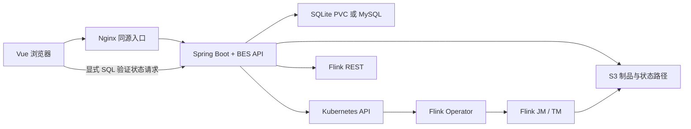

# 架构与数据流

更新：2026-10-19。依据当前代码；重要业务细则通过需求/模块导航，不在此重复。

- 平台部署：单 StatefulSet/Pod，前端 8080、后端 8081；NodePort 30080。同源 Session/CSRF 请求经过 Nginx；Flink UI 经后端验证登录、作业权限与目标路径后只读代理。
- 运行容器：Spring Boot 3.5.16 / Java17 使用用户提供的 BES 11.5.0.006 bundle，排除独立 Tomcat/EL 依赖；镜像从干净 Kylin 基础层按依赖/业务分层重建，不能继承上一版业务镜像。[构建与运行目录](modules/storage-runtime.md#bes-运行时与后端镜像2026-10-19)。
- 后端依赖：controller → service 接口 → impl → repository 或 collector/client；持久化 SQL 只在 repository/datasource。[分层检查](../../scripts/check_backend.py)验证该边界，Bean 构造注入和 `spring.factories` 均有动态用途。
- 草稿发布：表单/YAML → 结构/业务校验 → 变量/制品/模板渲染 → 权限、修订与资源身份检查 → Kubernetes dry-run → 实际提交 → 发布/操作记录。保存草稿只写数据库；受理状态不证明运行。
- 停止：持久化停止意图及加密的实际部署配置 → 提交挂起或带前置条件删除 → 手动刷新推进 → 确认保存点并先存恢复路径 → 删除 FlinkDeployment。参见 [生命周期模块](modules/job-lifecycle.md)。
- SQL：草稿/历史 → BASIC/精确 Parser → Application Runner，或唯一专用 Session 的 REST 上传/提交 → Print 输出限额 → 截止取消/清理。用户程序与 Connector 在 Flink 执行，后端不加载用户类。参见 [SQL 模块](modules/sql-session.md)。
- 文件：平台 S3 SDK 的浏览/上传/CopyObject/删除、下载器取程序文件、Flink 插件访问状态目录是三条独立连接路径。平台 SDK 连通不等于 Flink 状态访问成功。

## 数据结构与安全边界

[SchemaInitializer](../../backend/src/main/java/com/flinkweb/datasource/metadata/SchemaInitializer.java)依次执行两方言 V1–V5。`job_drafts` 保存草稿与自增编号，`job_bindings` 保存资源绑定，`platform_records` 保存配置/用户/SQL/Session/操作等带 revision 的 JSON 元数据，`platform_record_subjects` 提供历史主体索引。SQLite 文件锁与单连接约束当前单实例；MySQL 配置切换不迁移数据。

密码 BCrypt；配置密钥 AES-GCM；浏览器敏感字段一次性加密挑战。运行 YAML 预览和历史按各自规则脱敏；顶层 status 保留原值是已确认展示要求，不应误认为任意日志/快照完全无敏感信息。主密钥与数据库一起决定能否恢复已有加密配置，知识库只记录其变量名。

定时行为仅为显式 SQL 验证安排截止取消与清理重试（重启恢复）；没有常驻作业状态轮询或 watch。没有平台业务消息生产/消费循环；数据源 Kafka 客户端仅供显式探测。

架构约束索引：[按需观测](decisions/ADR-001-on-demand.md)、[身份与停止](decisions/ADR-002-safe-stop.md)、[存储与安全](decisions/ADR-003-storage-security.md)、[模板](decisions/ADR-004-templates.md)。
